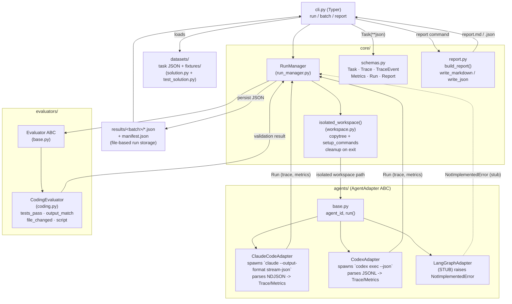

# agent-eval

Side-by-side evaluation system for AI coding agents. Runs the same coding tasks across multiple agents (Claude Code, Codex, LangGraph) and produces a structured comparison report. P0 works end-to-end for Claude Code and Codex; the LangGraph adapter is still a stub.

---

## Prerequisites

- Python 3.11+
- [Claude Code CLI](https://claude.ai/code) installed and authenticated (`claude` on PATH)
- [Codex CLI](https://github.com/openai/codex) installed and authenticated (`codex` on PATH)

---

## Setup

```bash
# Clone and enter the project
cd agent-eval

# Create and activate a project-local virtualenv
python3 -m venv .venv
source .venv/bin/activate

# Install dependencies
pip install -r requirements.txt
```

### Development / tests

```bash
# Dev dependencies (includes requirements.txt + pytest, ruff, mypy)
.venv/bin/pip install -r requirements-dev.txt

# Run the unit tests (offline — real agent CLIs are mocked / faked)
.venv/bin/python -m pytest
```

---

## Smoke Test

Verify the pipeline works end-to-end with a single task:

```bash
# Run one task against both agents (1 run each)
python cli.py run \
  --task datasets/tasks/example_fix_bug.json \
  --agents claude-code,codex \
  --runs 1

# Generate a report from the results
python cli.py report --input-dir results/ --output report.md

cat report.md
```

Expected output:
- Both agents should `PASS` the `fix-off-by-one` task
- `claude-code` typically finishes in ~7s with 3 turns
- `codex` typically finishes in ~15–20s with 1 turn
- Token counts and cost will be populated for Claude Code; cost will be `N/A` for Codex (not exposed by CLI)

---

## Full Batch Run

Run all 9 tasks across both agents:

```bash
python cli.py batch \
  --agents claude-code,codex \
  --runs 1

# Results land in results/batch_YYYYMMDD_HHMMSS/
# The command prints the exact path and a report command at the end
```

To run 3 times per task (recommended for stability measurement):

```bash
python cli.py batch --agents claude-code,codex --runs 3
```

---

## Generate a Report

```bash
# Markdown (default)
python cli.py report \
  --input-dir results/batch_YYYYMMDD_HHMMSS \
  --output report.md

# JSON (machine-readable)
python cli.py report \
  --input-dir results/batch_YYYYMMDD_HHMMSS \
  --output report.json
```

---

## Adding a New Task

1. **Create the fixture** under `datasets/fixtures/<task-id>/`:
   - `solution.py` — starting state (broken, incomplete, or stub)
   - `test_solution.py` — pytest tests that must pass after the agent fixes it

2. **Create the task JSON** at `datasets/tasks/<task-id>.json`:
   ```json
   {
     "id": "your-task-id",
     "description": "What you tell the agent — be specific and unambiguous",
     "workspace": "datasets/fixtures/your-task-id",
     "validator": {
       "type": "tests_pass",
       "config": { "command": "python -m pytest test_solution.py -v", "timeout_seconds": 30 }
     },
     "timeout_seconds": 120,
     "metadata": { "difficulty": "easy", "category": "bug-fix", "language": "python" }
   }
   ```
   `workspace` is a local directory path, relative to where you run `cli.py` (the repo root); it is copied in full for every run. Git URLs are not supported.

3. **Verify the fixture fails before the agent touches it:**
   ```bash
   .venv/bin/python -m pytest datasets/fixtures/your-task-id/test_solution.py -q
   # Must FAIL — if it passes, the task is trivially solved already
   ```

**Validator types:** `tests_pass` · `output_match` · `file_changed` · `script`

---

## Available Agents

| Agent ID | Backend | Tokens | Cost |
|----------|---------|--------|------|
| `claude-code` | `claude --output-format stream-json` | ✅ | ✅ |
| `codex` | `codex exec --full-auto --json` | ✅ | N/A |
| `langgraph` | Custom LangGraph agent (P1 stub) | TBD | TBD |

`Tools` in the report is not measured the same way across backends: Claude Code counts every `tool_use` block, Codex counts only `command_execution` items.

---

## Architecture



`langgraph` is wired into the adapter map but `run()` currently raises `NotImplementedError` — it's a P1 stub, not a working backend. An adapter exception currently aborts the whole `run`/`batch` command.

---

## Project Structure

```
agent-eval/
├── cli.py                        # Entry point: run / batch / report commands
├── core/
│   ├── schemas.py                # Shared data models (Task, Run, Trace, Metrics, Report)
│   ├── workspace.py              # Isolated workspace creation (temp dir per run)
│   ├── run_manager.py            # Orchestrates runs: workspace → agent → evaluator → persist
│   └── report.py                 # Aggregates runs into side-by-side report
├── agents/
│   ├── base.py                   # AgentAdapter interface
│   ├── claude_code.py            # Claude Code CLI adapter (stream-json trace)
│   ├── codex.py                  # Codex CLI adapter (JSONL trace)
│   └── langgraph_agent.py        # LangGraph adapter stub (P1)
├── evaluators/
│   ├── base.py                   # Evaluator interface
│   └── coding.py                 # Deterministic coding validators
├── datasets/
│   ├── tasks/                    # Task JSON definitions
│   └── fixtures/                 # Per-task workspace snapshots (buggy code + tests)
├── tests/                        # pytest unit tests (offline, fake adapters)
├── docs/                         # history.md build log, feature-request.md open requests
├── pyproject.toml                # Package metadata + `agent-eval` console script
├── requirements.txt              # Runtime dependencies
├── requirements-dev.txt          # Dev/test dependencies (pytest, ruff, mypy)
├── pytest.ini                    # pytest config
├── report.md                     # Sample report (fix-off-by-one, 2 runs × 2 agents)
└── results/                      # Run outputs (gitignored)
    └── batch_YYYYMMDD_HHMMSS/
        ├── manifest.json
        └── <task>__<agent>__<run-id>.json
```

---

## Design Trade-offs

- **Isolation by copying into a temp dir.** Each run gets a fresh `copytree` of the fixture, so runs cannot contaminate each other. Cheap and simple for small fixtures; gives up git-based checkouts and container-level isolation for now.
- **Deterministic validators only.** Success is decided by tests / output / file checks, never by an LLM judge, so results are reproducible. Judge-based scoring is deferred (P2) and would be labeled separately.
- **External CLIs, observable traces only.** Adapters wrap the real `claude` / `codex` CLIs and normalize their streamed events; no access to internal reasoning. Telemetry a backend doesn't expose stays `None` (shown as `N/A`), never 0.
- **File-based storage.** One JSON per run plus a batch `manifest.json`; easy to inspect and diff. A database (SQLite/Postgres) is a P2 item for regression analysis.

---

## Status

P0 is done for Claude Code and Codex (isolation, adapters, traces, metrics, deterministic validation, repeated runs, side-by-side report). LangGraph is a stub; P1 items (failure taxonomy, trace-derived metrics, aggregate reports) are not started. See [CLAUDE.md](CLAUDE.md#current-status) for progress, next steps, and known pitfalls; open feature requests are in [docs/feature-request.md](docs/feature-request.md), build history in [docs/history.md](docs/history.md).
